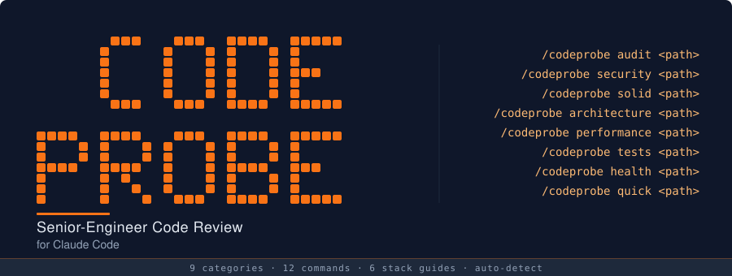

# CodeProbe

<p align="center">
  
</p>

<p align="center">
  <a href="#install"></a>
  
  
  
</p>

Senior-engineer code review as an [agent skill](https://skills.sh). Run `/codeprobe audit .` and get a full health report in minutes.

- **9 review categories** -- security, SOLID, architecture, error handling, performance, test quality, code smells, design patterns, framework best practices
- **Severity-scored findings** with file locations and copy-pasteable fix prompts
- **Verified findings** -- an independent verifier re-checks every Critical and Major finding and drops false positives before scoring
- **Auto-detects your stack** -- Python, TypeScript, React/Next.js, PHP/Laravel, SQL, and more
- **Strictly read-only** -- never modifies your code
- **Works with 45+ agents** -- Claude Code, Cursor, Codex, Windsurf, Cline, and more

---

## What's New in v2.3.0

- **Verified findings.** After the category reviewers finish, an independent verifier agent re-checks every Critical and Major finding against the code and confirms it, downgrades it one severity level, or rejects it as a false positive. Rejected findings no longer count against your score; the dashboard shows how many were rejected, and the saved report lists them in a collapsed section so you can disagree. Verification adds roughly a third to an audit's cost -- set `"verify": false` in [the config](#configuration) to skip it.
- **Install as a Claude Code plugin** -- `/plugin marketplace add machine-room-dev/codeprobe`, then `/plugin install codeprobe@codeprobe`. The skills.sh install keeps working. See [Install](#install-as-a-claude-code-plugin).
- **Single-category commands save a report** -- `/codeprobe security .`, `/codeprobe tests .` and the rest now show every finding in full, with its severity rationale, and save the report to `./codeprobe-reports/`.
- **Leaner, more faithful sub-agents** -- each reviewer now reads its own skill file directly instead of having it pasted into its prompt (where it could get condensed), so detection rules arrive intact and each agent's start-up message drops from 10 KB+ to about 2 KB.
- **More reliable runs** -- the skill runs one simple shell command at a time; chained commands were being blocked by permission checks, which could knock a run off course and leave the report filename without its timestamp.
- **Regression evals** -- a planted-defect project with six must-find Critical bugs and five safe-looking "baits" that must not be flagged, runnable with `claude plugin eval`, so every change to the skill (or the model under it) is measured. See [`evals/README.md`](evals/README.md).

---

## Sample Output

Every `/codeprobe audit` opens with a **health dashboard** (category scores, codebase stats, hot-spot files), then lists detailed P0–P3 findings with severity rationales and fix prompts, and saves the whole report to `./codeprobe-reports/<project>-<cmd>-<timestamp>.md`.

### Code Health Report — growth-engine

**Overall Health:** 58/100 [Critical]

**Category Scores**

| Category | Score | Bar | Status |
|---|---|---|---|
| Security | 72/100 | `██████████████░░░░░░` | Needs Attention |
| SOLID | 45/100 | `█████████░░░░░░░░░░░` | Critical |
| Architecture | 55/100 | `███████████░░░░░░░░░` | Critical |
| Error Handling | 38/100 | `████████░░░░░░░░░░░░` | Critical |
| Performance | 62/100 | `████████████░░░░░░░░` | Needs Attention |
| Test Quality | 48/100 | `██████████░░░░░░░░░░` | Critical |
| Code Smells | 65/100 | `█████████████░░░░░░░` | Needs Attention |
| Patterns | 78/100 | `████████████████░░░░` | Needs Attention |
| Framework | 86/100 | `█████████████████░░░` | Healthy |

**Codebase:** 391 files · 64,146 LOC · Python 3.11 / FastAPI + Next.js / PostgreSQL / Redis

**Hot spots:**

1. `services/order_processor.py` — 7 categories flagged (SOLID, Error Handling, Performance, Code Smells, Test Quality, Patterns, Architecture)
2. `api/routers/checkout.py` — 5 categories flagged (Security, SOLID, Error Handling, Performance, Test Quality)
3. `frontend/src/pages/dashboard.tsx` — 4 categories flagged (Architecture, Code Smells, Patterns, Test Quality)

**Rejected by verification:** 2

**Executive Summary:** Systemic issues across four categories. The biggest blocker is **error handling (38)** — 14 swallowed exceptions in payment paths, no top-level `try/except` in any of the three async workers, and transaction boundaries leak across service calls. **SOLID (45)** is dominated by `OrderProcessor` as a 1,420-LOC god class handling pricing, inventory, fulfillment, and notifications. **Architecture (55)** has a bidirectional dependency between `services/` and `api/` that makes the checkout path near-impossible to test in isolation. Security (72) is mostly sound but string-concatenation SQL in `reports/query_builder.py:88` needs to be fixed before the next release.

**Critical (P0 — 2 findings):**

- **SEC-001** | `reports/query_builder.py:88` — SQL built with string concatenation against the unsanitized `filters` request param. Direct injection via `POST /reports`. **Severity rationale:** Critical (not Major) because the endpoint is public, unauthenticated, and user input flows directly into the SQL string — exploitable as-is, no preconditions. **Fix:** parameterize with SQLAlchemy `text(...)` + bind params, or move the query to the ORM.
- **ERR-007** | `workers/payment_worker.py:42-139` — `process_refund` wraps the Stripe call in a bare `try/except Exception: pass`. Failed refunds are silently dropped from the retry queue. **Severity rationale:** Critical (not Major) because dropped refunds cause real financial loss and the silent swallow means no operator signal — data-loss path, not just a reliability risk. **Fix:** catch `stripe.error.StripeError` explicitly, enqueue the payload on a dead-letter queue, alert on `InvalidRequestError`.

**Top Major (P1 — of 14):**

- **ARCH-003** | `services/order_processor.py` ↔ `api/routers/checkout.py` — Bidirectional coupling: the service imports router types for validation while the router constructs service internals directly. Blocks both service-level unit tests and independent router evolution. **Severity rationale:** Major (not Minor) because the checkout path cannot be tested in isolation and every change in this area ships unverified to a revenue-critical flow; not Critical because it is a structural risk, not a confirmed defect or exploit. **Fix:** introduce `checkout/schemas.py` as a dependency-free Pydantic layer both sides depend on.

```
--> Report saved to ./codeprobe-reports/growth-engine-audit-2026-04-23-221047.md
```

---

## Install

```bash
npx skills add machine-room-dev/codeprobe
```

Then run `/codeprobe audit .` in any project.

**Manage:** `npx skills update` • `npx skills remove`

**Optional:** Python 3.8+ enables codebase statistics in the `/codeprobe audit` dashboard.

**Reports are saved** to `./codeprobe-reports/<project>-<cmd>-<timestamp>.md` in your current directory (e.g. `growth-engine-audit-2026-04-23-221047.md`) — the filename tells you which project and which command the report came from at a glance. Add `codeprobe-reports/` to your `.gitignore` to keep them out of source control.

### Install as a Claude Code plugin

```bash
/plugin marketplace add machine-room-dev/codeprobe
/plugin install codeprobe@codeprobe
```

Or from a shell: `claude plugin marketplace add machine-room-dev/codeprobe && claude plugin install codeprobe@codeprobe`.

Plugin installs invoke `/codeprobe:codeprobe audit .` (and `/codeprobe:codeprobe <command> <path>` for the rest); skills.sh installs keep `/codeprobe audit .`.

A plugin install copies the whole repository into Claude Code's plugin cache, including `evals/`, whose planted-defect fixture holds deliberately fake credentials (such as a `sk-live-`-style key) that secret scanners may flag.

---

## Commands

| Command | Description |
|---------|-------------|
| `/codeprobe audit <path>` | Full audit -- health dashboard (scores, file statistics, hot spots) plus detailed findings with fix prompts |
| `/codeprobe diff [base]` | PR-style review of changed files vs a base branch (default `main`, fallback `master`) -- output is paste-ready as a GitHub PR comment |
| `/codeprobe quick <path>` | Top 5 most impactful issues with fix prompts |
| `/codeprobe security <path>` | Security vulnerability detection |
| `/codeprobe solid <path>` | SOLID principles analysis |
| `/codeprobe architecture <path>` | Architecture and dependency analysis |
| `/codeprobe performance <path>` | Performance audit |
| `/codeprobe errors <path>` | Error handling audit |
| `/codeprobe tests <path>` | Test quality audit |
| `/codeprobe smells <path>` | Code smell detection |
| `/codeprobe patterns <path>` | Design patterns analysis |
| `/codeprobe framework <path>` | Framework best practices |

If no path is given, the current working directory is used. Installed as a plugin? Prefix each command as `/codeprobe:codeprobe <command> <path>` -- see [Install as a Claude Code plugin](#install-as-a-claude-code-plugin).

### Running on a specific path

The `<path>` argument works the same way for every command above. It can be a directory *or* a single file, and can be relative or absolute.

```bash
# Current directory (same as passing no path)
/codeprobe audit .

# A subdirectory
/codeprobe audit ./src/backend

# An absolute path
/codeprobe audit /Users/me/projects/myapp

# A single file
/codeprobe audit ./src/api/auth.ts

# Scope a single category to a subfolder
/codeprobe security ./src/api
/codeprobe solid    ./backend/services
/codeprobe quick    ./src/checkout
```

**Notes on paths:**

- Relative paths are resolved against the directory Claude Code was started in.
- Only files inside the given path are analyzed — everything else is ignored.
- Every command except `quick` (which prints to the terminal only) saves its report to `./codeprobe-reports/<project>-<cmd>-<timestamp>.md` in your **current working directory**, regardless of which path you scanned. `cd` into the project first if you want the report to land there. The `<project>` segment is derived from the basename of the path you scanned (extension stripped for single-file scans), so reports from different projects in the same directory remain distinguishable.

---

## How It Works

The system uses an **orchestrator + sub-skill** architecture:

1. **Orchestrator** (`skills/codeprobe/SKILL.md`) -- Routes commands, detects your tech stack, loads config, and spawns the specialized sub-skills **in parallel** as independent agents. Each agent receives a file manifest and reads only the files its domain needs, so audits stay fast and token-lean even on larger codebases.
2. **Sub-skills** -- Domain experts that each analyze one category:
   - `codeprobe-security` -- SQL injection, XSS, hardcoded secrets, auth issues
   - `codeprobe-error-handling` -- Swallowed exceptions, missing try/catch, transaction safety
   - `codeprobe-solid` -- Single Responsibility, Open/Closed, Liskov, Interface Segregation, Dependency Inversion
   - `codeprobe-architecture` -- Coupling, layering violations, circular dependencies, god objects
   - `codeprobe-patterns` -- Design pattern opportunities and anti-patterns
   - `codeprobe-performance` -- N+1 queries, unbounded queries, algorithmic efficiency, caching
   - `codeprobe-code-smells` -- Long methods, deep nesting, duplicate code, primitive obsession
   - `codeprobe-testing` -- Missing tests, test smells, mock abuse, coverage gaps
   - `codeprobe-framework` -- Laravel, React/Next.js, Python/Django framework idiom violations
3. **Reference guides** (`skills/codeprobe/references/`) -- Stack-specific best practices loaded based on auto-detected languages.
4. **Scripts** (`skills/codeprobe/scripts/`) -- Deterministic analysis utilities:
   - `file_stats.py` -- LOC, file counts, method counts per file
   - `complexity_scorer.py` -- Cyclomatic complexity per function
   - `dependency_mapper.py` -- Import graph and circular dependency detection
5. **Verification** -- After the sub-skills return, an independent verifier agent re-checks every Critical and Major finding against the code (`quick` verifies the Critical and Major findings among its top 8 candidates) and either confirms it, downgrades it by one severity bucket, or rejects it; Minor and Suggestion findings are not verified. Rejected findings are removed before deduplication and scoring and counted on the `Rejected by verification` line; the saved reports of `audit` and single-category commands also list them in a collapsed "Rejected by Verification" section so you can disagree. Set `"verify": false` in the config to skip the pass.
6. **Regression evals** (`evals/`) -- A planted-defect fixture project plus expected findings (`evals/expected-findings.md`), run as `claude plugin eval` cases for checking severity stability, dedup, scoring, and verification whenever the skill or the underlying model changes. Run it from the repo root; the cost table is in `evals/README.md`:

   ```bash
   claude plugin eval . --ablation none --scaffold --trust-plugin --no-publish \
     --max-cost-usd 40 \
     --allow-tools Write "Bash(python3 *)" "Bash(mkdir *)" "Bash(wc *)" "Bash(date *)"
   ```

Stack detection is automatic. The orchestrator scans for file extensions and project markers (e.g., `next.config.*`, `migrations/` directory) and loads the appropriate reference guides.

---

## Scoring

Each category is scored independently:

```
crit_penalty  = min(50, critical_count * 15)
major_penalty = min(30, major_count * 6)
minor_penalty = min(10, minor_count * 2)

category_score = max(0, 100 - crit_penalty - major_penalty - minor_penalty)
```

Suggestions do not affect scores. Findings rejected by verification are removed before scoring. The overall score is a weighted average of active categories:

| Category | Weight |
|----------|--------|
| Security | 20% |
| SOLID | 15% |
| Architecture | 15% |
| Error Handling | 12% |
| Performance | 12% |
| Test Quality | 10% |
| Code Smells | 8% |
| Design Patterns | 4% |
| Framework | 4% |

| Score Range | Status |
|-------------|--------|
| 80-100 | Healthy |
| 60-79 | Needs Attention |
| 0-59 | Critical |

---

## Configuration

Create a `.codeprobe-config.json` in your project root to customize behavior:

```json
{
  "severity_overrides": {
    "long_method_loc": 50,
    "large_class_loc": 500,
    "deep_nesting_max": 4,
    "max_constructor_deps": 6
  },
  "skip_categories": ["codeprobe-testing"],
  "skip_rules": ["SPEC-GEN-001"],
  "framework": "laravel",
  "extra_references": [],
  "report_format": "markdown",
  "verify": true
}
```

All fields are optional. If the file is absent, defaults apply. If `skip_categories` is set, weights are normalized to 100%. `verify` (default `true`) runs the verification pass on Critical and Major findings; `false` skips it and drops the `Rejected by verification` line.

---

## Stack Support

Auto-detected languages and frameworks with dedicated reference guides:

- **Python** -- PEP standards, Django/Flask patterns, type hinting
- **JavaScript / TypeScript** -- ES modules, async patterns, type safety
- **React / Next.js** -- Component patterns, hooks, SSR/SSG
- **PHP / Laravel** -- Eloquent, service patterns, blade templates
- **SQL / Database** -- Query optimization, schema design, migrations
- **API Design** -- REST conventions, validation, error responses

Additional languages recognized for file statistics: Java, Ruby, Go, Rust, Vue, Svelte, Shell, CSS/SCSS, HTML.

---

## Claude.ai Support

When used on Claude.ai (without filesystem access), the skill runs in **degraded mode**: it analyzes pasted or uploaded code directly, skips codebase statistics and diff review, and notes the limitation. Findings and scoring still work normally.

## License

MIT

## Author

Nishil -- [Machine Room](https://themachineroom.dev) ([YouTube @MachineRoomDev](https://www.youtube.com/@MachineRoomDev))
